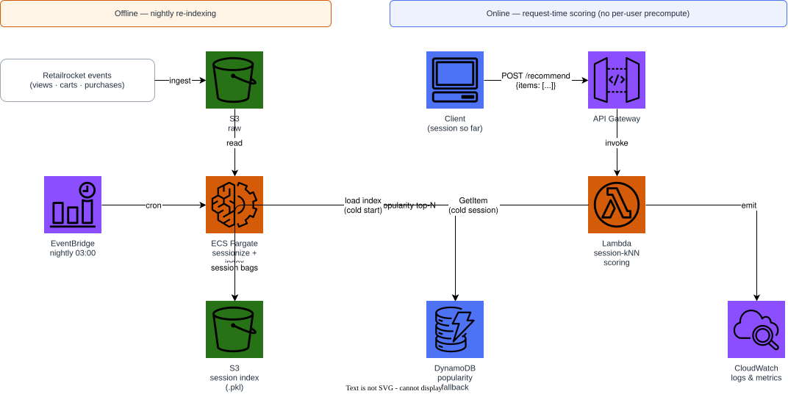
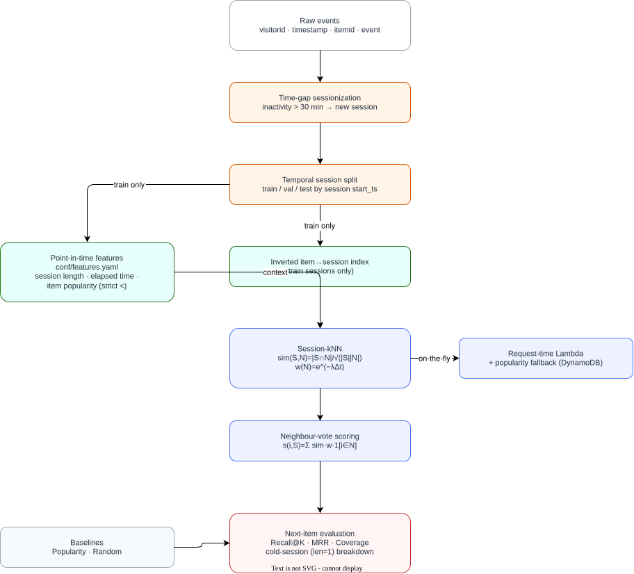

# Retailrocket Session-kNN

Session-based k-Nearest-Neighbours recommender for the [Retailrocket
e-commerce dataset](https://www.kaggle.com/datasets/retailrocket/ecommerce-dataset):
anonymous browsing events (`view` / `addtocart` / `transaction`) with no
persistent, reliable user identity across visits. Classical ML only -- no
neural networks, no PyTorch/TensorFlow/Keras, no gradient-descent-trained
embeddings, no RNN/GRU/Transformer.

📄 [**Read the full technical report**](paper/main.pdf) -- methodology,
equations, point-in-time feature contracts, and the honest results
discussion summarised below.

## Problem statement

Retailrocket's `visitorid` is a browser cookie, not a durable account: it
churns across devices and sessions, and the typical session contains only a
handful of events before the visitor leaves. A model built around a
persistent user profile is solving a problem that barely exists in this
data. Session-based k-Nearest-Neighbours (session-kNN) instead represents
the *current, partial* session as a set of recently viewed items, retrieves
the most similar *past* sessions, and lets those neighbours vote on the next
item -- a strong, fully classical baseline for session-based recommendation
that needs no sequence model.

## Quickstart

```bash
pip install -e ".[dev]"
python scripts/download_data.py --synthetic   # or --kaggle with KAGGLE_USERNAME/KAGGLE_KEY

PYTHONPATH=src python -m recommender.cli train
PYTHONPATH=src python -m recommender.cli evaluate --partition test
PYTHONPATH=src python -m recommender.cli recommend --session-id <id> --partition test --k 10

pytest -q
ruff check src tests scripts
```

> `PYTHONPATH=src` (or an editable install, `pip install -e .`) makes the
> `recommender` package importable; `pytest` already does this via
> `pythonpath = ["src"]` in `pyproject.toml`.

## Method

The session-session similarity, recency weighting, and scoring function
(derived and discussed in full in `paper/sections/04-methodology.tex`):

```
sim(S, N) = |S ∩ N| / sqrt(|S| |N|)        cosine on binary item sets (primary)
sim(S, N) = |S ∩ N| / |S ∪ N|              Jaccard (ablation)
w(N)      = exp(-λ Δt)                     recency decay of neighbour sessions
s(i, S)   = Σ_{N ∈ 𝒩(S)} sim(S,N) · w(N) · 1[i ∈ N]
```

Sessions themselves are constructed by time-gap segmentation: a new session
starts whenever the inactivity gap since a visitor's previous event exceeds
30 minutes.

## Results (synthetic fixture, test partition, K=20)

| Model | Recall@20 | MRR@20 | Coverage | Recall@20 (cold) | N cold |
|---|---|---|---|---|---|
| **SessionKNN** | **0.3545** | 0.1701 | 0.9300 | 0.4356 | 489 |
| Popularity | 0.3459 | 0.1490 | 0.0675 | 0.4601 | 489 |
| Random | 0.0478 | 0.0089 | 1.0000 | 0.0511 | 489 |

Session-kNN modestly outperforms a tuned popularity baseline on Recall@20
and MRR@20 while covering **13.8x** more of the catalogue. In the hardest,
single-item "cold session" regime, popularity is slightly ahead -- reported
honestly rather than tuned away (see `paper/sections/06-results.tex`).
Regenerate this table from a live run with:

```bash
python scripts/export_results_table.py
```

## Feature engineering

Every feature is declared in `conf/features.yaml` and implemented in exactly
one of `src/recommender/features/{user,item,interaction,context}_features.py`.
Interaction aggregates (`item_popularity_count`, `visitor_prior_session_count`)
are fitted on the training partition only and tested with a strict `<`
cut-off; session-local features (`session_length_so_far`,
`time_since_session_start`) are point-in-time by construction, since they
read only strictly-earlier positions within the same session.

| Feature | Family | Fit scope | Point-in-time |
|---|---|---|---|
| `item_popularity_count` | item | `train_only` | ✓ |
| `item_category` | item | `catalogue` | -- |
| `visitor_prior_session_count` | user | `train_only` | ✓ |
| `session_length_so_far` | interaction | `none` | ✓ |
| `time_since_session_start` | interaction | `none` | ✓ |
| `hour_of_day` | context | `none` | -- |
| `is_weekend` | context | `none` | -- |

Leakage, schema, and offline/online parity are enforced by
`tests/test_features_leakage.py`, `tests/test_features_schema.py`, and
`tests/test_features_parity.py`.

## Architecture

**AWS serving path** (Floci-first, real-AWS escape hatch via `use_floci=false`):



Session-kNN has no stable per-entity key to precompute a top-N list
against -- a session does not exist until it starts, and `visitorid` is an
unreliable cookie. Every request therefore posts the items viewed so far and
is scored **on-the-fly** in Lambda against the session index pulled from S3;
the only precomputed artifact is a single, session-independent popularity
fallback row in DynamoDB, used when a request carries no recognised item.

**Modelling pipeline:**



## Infrastructure

```bash
docker compose up -d                 # start Floci (the AWS emulator) on :4566
cd terraform
terraform init
terraform validate
terraform apply -auto-approve        # S3, DynamoDB fallback table, Lambda, EventBridge, CloudWatch
terraform output
```

Point the same configuration at real AWS with `terraform apply -var
use_floci=false -var aws_region=<region>`. See `terraform/README.md` for the
full variable reference and design notes.

### Cost and cleanup

Everything above is free on Floci. On real AWS at portfolio traffic: S3
under $0.05/month, DynamoDB on-demand under $1/month, Lambda within the free
tier.

```bash
terraform destroy -auto-approve
docker compose down
```

## Repository layout

```
conf/                 declarative feature specification (point-in-time)
data/                 .gitkeep only -- real/synthetic data is never committed
docs/                 architecture diagrams (drawio + rasterized svg/png)
paper/                LaTeX technical report, built reproducibly (main.pdf committed)
scripts/              data generation, diagram export, table export
src/recommender/      sessionization, features, session-kNN, evaluation, serving
terraform/            Floci-first infrastructure (S3, DynamoDB, Lambda, EventBridge)
tests/                pytest suite incl. leakage/schema/parity tests
```

## License

MIT, see `LICENSE`.
